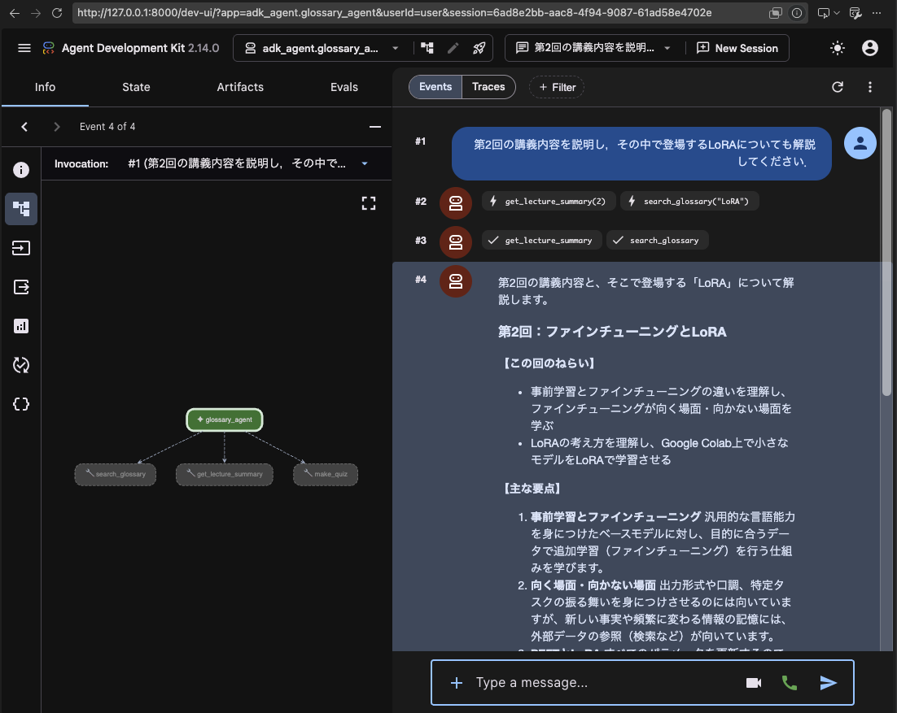
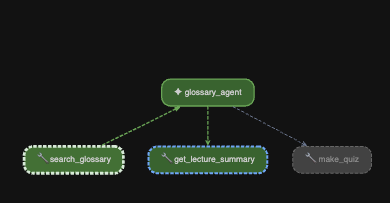

# 第3回 解答

## 演習

- 第1回（素のLLM）とエージェントの回答の違い：
  - 第1回で用いた素のLLMの回答では，一般的な3レベルについて複数パターンで解説した後に正確な確認方法を最後に提案されたが，エージェントの回答では，レベルが基礎，実装，応用の3レベルであり，どれか1つのレベルに取り組めばいいことも含めて素のLLMに比べて完結に出力された．
- `--trace` で見えたツール呼び出し（ツール名と引数）：
  - 「LoRAとQLoRAの違いは？」という質問を投げた
    - [tool call]   search_glossary({'query': 'LoRA'})
    - [tool call]   search_glossary({'query': 'QLoRA'})
- 1つの質問での LLM 呼び出し回数（`requests`）：
  - 「LoRAとQLoRAの違いは？」という質問を投げた
    - "requests=2" -> 2回
- 追加したツールと、docstring に書いた説明：
  - 追加したツール：`make_quiz`
  - dacstringに書いた説明：指定した回の用語から 1つを選び、確認問題と答えを返す。「第2回の確認問題を出して」のように、復習用の問題を求められたときに使う。

## 宿題

- 取り組んだレベル：基礎 / 実装 / 発展

  - 発展
- やったこと：

  - 学習支援エージェントをGoogle ADKで再実装し，同じモデル・指示・ツールを用いて質問応答を行い，実装方法と回答の違いを比較する．
- 結果：2つの質問で比較＋正しいtoolが使われているか調査（出力は斜体で示す．）

  - 「第2回の確認問題を出して」と質問（単純な質問）

    #### - **agent.pyでの結果**

    *第2回から確認問題を1問出しますね！*

    ***【確認問題】**
    「学習率」の意味は？*

    *第2回*

    #### - **ADKでの結果**

    *それでは、第2回からの確認問題です！*

    ***【問題】**
    「過学習」の意味は？*

    *（考えてみたら、ぜひあなたの言葉で答えてみてくださいね！）*

    *第2回*

    - どちらで質問した場合もあまり変化がなかった．ADKの方では最後に回答を求める文章を生成した．
  - 「第2回の講義内容を説明し，その中で登場するLoRAについても解説してください．」と質問（複数のツールを呼び出すことを想定した質問）

    #### - **agent.pyでの結果**

    *第2回「ファインチューニングとLoRA」の講義内容と、そこで登場する「LoRA」について解説します。*

    ### *第2回の講義内容*

    *第2回では、事前学習済みのモデルを目的に合わせて追加学習させる「ファインチューニング」の基礎と実践を学びます。*

    - ***事前学習とファインチューニングの違い***
      - ***事前学習**：汎用的な言語能力を身につけさせる。*
      - ***ファインチューニング**：目的に合うデータ（入力と望ましい出力のペアなど）で追加学習（SFT）し、出力形式や口調、特定タスクの振る舞いを身につけさせる。新しい事実を教え込むよりも、出力の形式やトーンの調整に向いている。*
    - ***演習（Google Colab）***
      - *小さなモデル（Qwen3.5-0.8B）を架空のFAQデータでLoRA学習させ、JSON形式の遵守率や内容正解率が学習前後でどう変わるかを体験する。*
      - *過学習（学習データに過剰適応すること）への注意点や、検証データによる確認も学ぶ。*

    ### *LoRA（Low-Rank Adaptation）とは*

    *用語集によると、LoRAの定義は以下の通りです。*

    > *事前学習済みの重みは固定したまま、重みの更新分を2つの小さな行列の積（低ランク行列）で表し、その小さな行列だけを学習するPEFT手法。学習するパラメータが少なく、学習結果（アダプタ）も小さいファイルで保存できる。*
    >

    ***主な特徴：***

    - *モデル全体の重みをすべて更新（フルファインチューニング）するのではなく、ごく一部の「低ランク行列（アダプタ）」だけを学習するため、必要なGPUメモリや保存容量を大幅に削減できる。*
    - *講座の演習では、限られたGPU環境でも効率よくモデルをカスタマイズする手法として実際に手を動かして体験する。*

    *関連する回：第2回*

    #### - **ADKでの結果**

    *第2回の講義内容と「LoRA」についてご説明します。*

    ### *第2回：ファインチューニングとLoRAの概要*

    *第2回では、事前学習とファインチューニングの違いを学んだうえで、効率的な追加学習手法である「PEFT（Parameter-Efficient Fine-Tuning）」や「LoRA」について学びます。
    主な要点は以下の通りです。*

    * ***事前学習とファインチューニング**：事前学習で汎用的な能力を身につけたモデルを、追加データで最適化する仕組みや、向いている場面・向かない場面を理解します。*
    * ***SFT（教師あり微調整）**：入力と望ましい出力のペアを用いて、出力形式や口調などを学習させます。*
    * ***過学習の注意**：学習データに特化しすぎないよう、検証データを用いて確認することの重要性を学びます。*
    * ***演習**：Google Colab上で小さなモデルを架空のFAQデータでLoRA学習させ、学習前後での出力変化を体験します。*

    *（関連回：第2回）*

    ### *LoRA（Low-Rank Adaptation）とは*

    *用語集の定義によると、LoRAとは以下のような手法です。*

    * ***定義**：事前学習済みの重みは固定したまま、重みの更新分を2つの小さな行列の積（低ランク行列）で表し、その小さな行列だけを学習するPEFT手法です。*
    * ***特徴**：学習するパラメータが少なくて済むため、必要なGPUメモリや保存容量を大幅に削減できます。また、学習結果を「アダプタ」と呼ばれる小さなファイルとして扱えます。*
    * ***関連用語**：ランク（LoRAの $r$ ）や、さらにベースモデルを量子化して省メモリ化する「QLoRA」といった発展手法も合わせて学びます。*

    *（関連回：第2回）*
  - どちらも正しくツールを呼び出せているように見える．説明に関しては，ADKの方が箇条書き形式でまとまっているように感じた．
  - 正しく呼び出せているか確認した

    - agent.pyは--traceを用いて検証 -> 正しく2つのツールを呼び出せていることを確認

      - [tool call]   get_lecture_summary({'lecture': 2})
      - [tool call]   search_glossary({'query': 'LoRA'})
    - ADKはADK Web UIを用いて検証

      - 右のロボットの発言から「get_lecture_summary」「search_glossary」を使っていることを確認
        
      - 実行中は以下のように左側の画面で色が変わっていることから確認できた

      
- 気づき・疑問：agent.pyを利用する場合とADKとで明確な差が出る質問を見つけられなかったので気になった．
